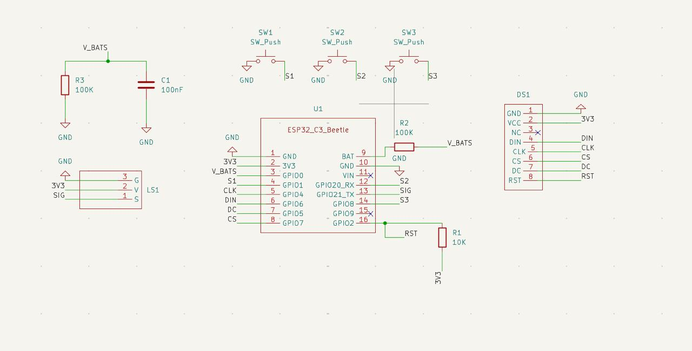
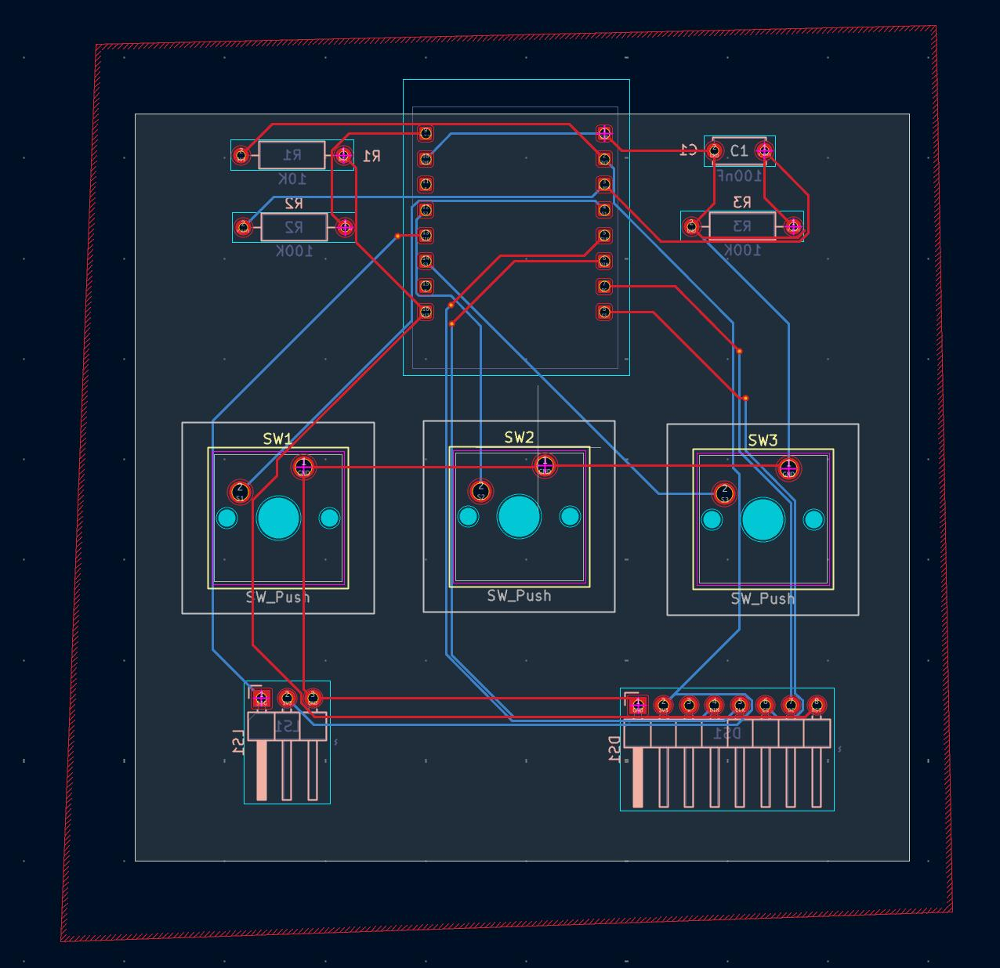
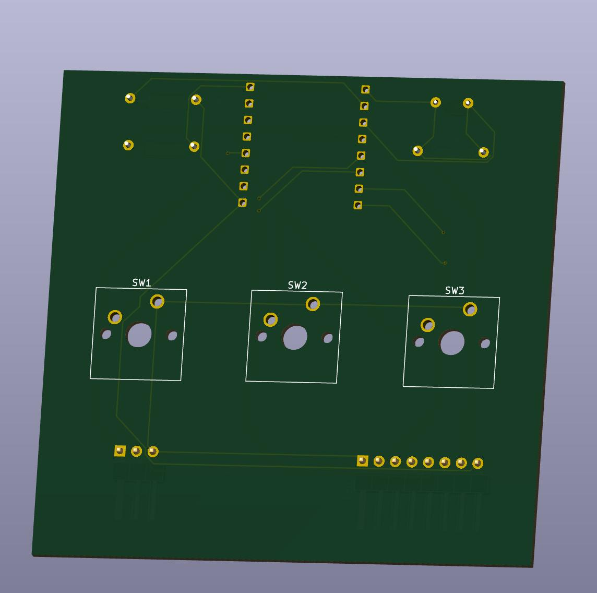
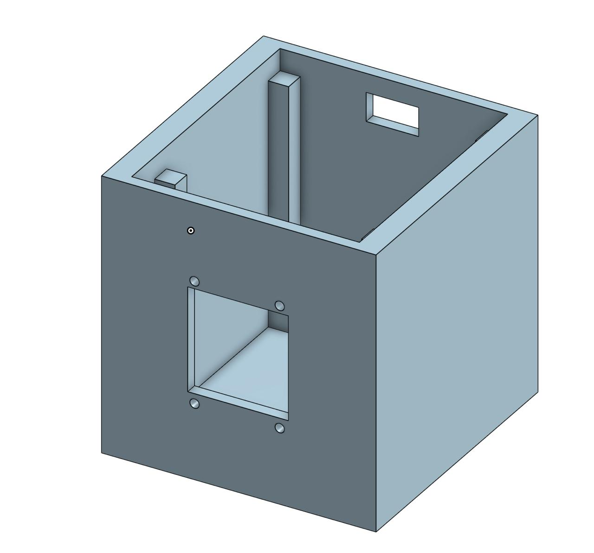
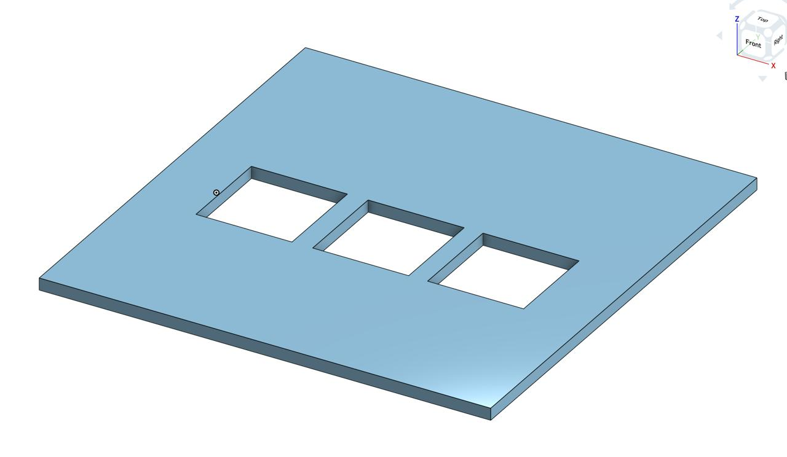
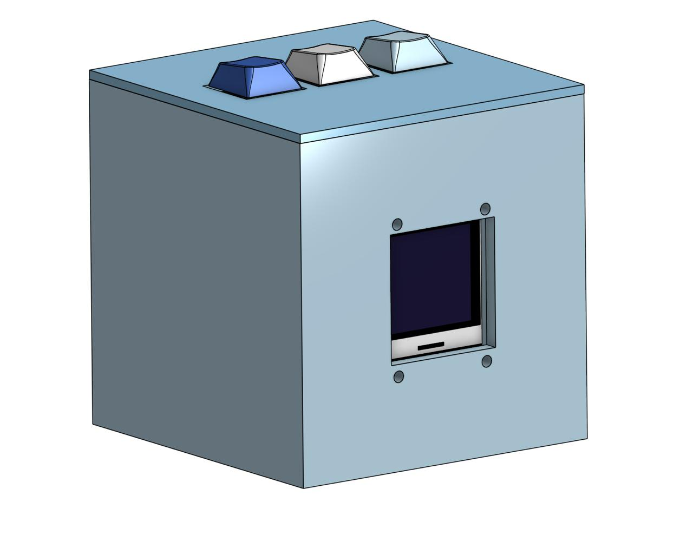

<h2>DESK STUDY BUDDY</h2>

Built for company while long study sessions right on your desk!

It includes 4 screen pages, has an in-built Pomodoro time tracker for increased focus during sessions, battery level indication and it also blinks. The 3D case is nearly a cube and less than 10cm in each dimension. It is small, doesn't use up too much space on your desk so that you can read more books at once!

<h3>Detailed Components List:</h3>

| Component | Quantity | Status | Price (INR) |
|---|---:|---|---:|
| DFRobot Beetle ESP32-C3 RISC-V development board | 1 | Order | 1009 |
| Waveshare 128×128 1.5-inch OLED display module | 1 | Order | 1369 |
| ACEBOTT passive buzzer module | 1 | Order | 239 |
| NOVA 603048 3.7V 900mAh LiPo battery pack | 1 | Already have | — |
| Cherry MX switches | 3 | Already have | — |
| 10 kΩ resistor | 1 | Already have | — |
| 100 kΩ resistors | 2 | Already have | — |
| 100 nF capacitor | 1 | Already have | — |
| 2.54 mm 1×08 OLED header | 1 | Already have | — |
| 2.54 mm 1×03 buzzer header | 1 | Already have | — |
| Desk Buddy custom PCB | 1 | Buy | — |
| 3D-printed enclosure | 1 | Print separately | — |

<h3>Schematics</h3>
 
This is the schematics design for the Desk Buddy that defines all the connections across each component.

<h3>PCB</h3>
 
This is the PCB design for the Desk Buddy that routes all components and places them as they will be placed in the final PCB.

  
After you print your PCB and receive all the require components, it is time to solder them to their respective places as indicated in the PCB. Except the components to be soldered on the PCB, you also need to solder the li-po battery's terminals onto your ESP32-C3.
 

<h3>PCB 3D view</h3>
This is the expected 3D view of the expected PCB after soldering of all components.

  
After soldering the PCB, screw the OLED display on to the front of the main case in the specific holes, ensuring the display is visible through the gap. 
After that, place the PCB on the 4 tall legs inside the main case shown and ensure they are fixed there. Place the Li-Po battery down so that it does not interfere with the placement of the Top Case later.

 
<h3>Main Case</h3>
This is the main case of the Desk Buddy

  
After placing the PCB and OLED display in the require positions, use the Top Cover to close the desk buddy ensuring the key caps easily come out of the given gaps. Stick the Top Cover to the main case firmly.

<h3>Top Cover</h3>
This is the Top Cover for the Desk Buddy.

  
The mechanical build for the Desk Buddy is ready. Now only the firmware awaits.

<h3>Final Assembly</h3>
This is the expected final look of the desk buddy!

  
For firmware, connect your ESP32-C3 with your computer with a cable. Open your Arduino IDE and select the required board and port. Lastly upload the firmware code (that can be downloaded from this repo) through the Arduino IDE and we are done. 

Our Desk Buddy would also work without connecting to the computer all the time as we have a separate battery to power it. The firmware also shows the battery level on our OLED display so you will need to keep charging the Desk Buddy as and when required. 

Thank you! Let's all keep studying with our desk study buddy!
